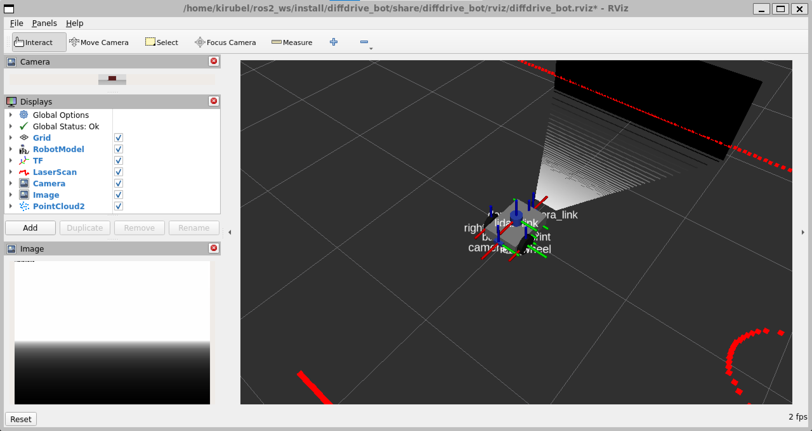
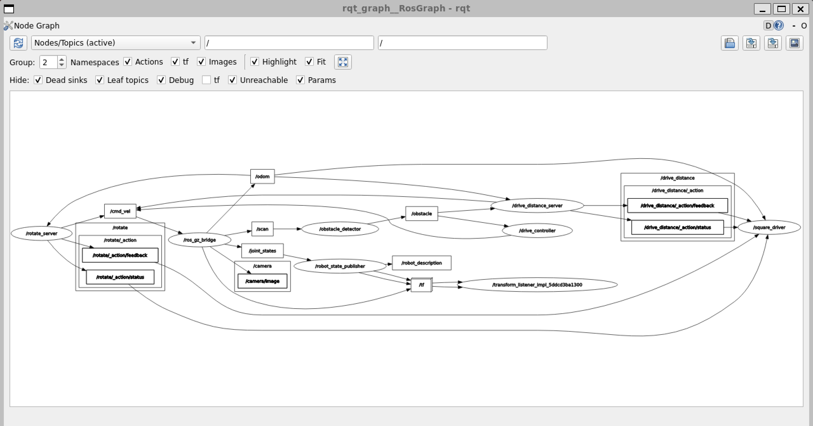

# Lab 1 Exercise: diffdrive_bot

My solution to the Lab 1 exercise of Introduction to Robotics and Intelligent Systems.

| Package | What it is |
|---------|------------|
| `diffdrive_bot` | The lab robot, with a depth camera and an IMU added (Step 1) |
| `lab_interfaces` | The lab's message, service and action types, unchanged |
| `my_robot_interfaces` | My types: `RobotStatus.msg`, `SetTurnSpeed.srv`, `Rotate.action` |
| `my_robot_nodes` | My nodes `turn_away`, `rotate_server`, `square_driver` and `square.launch.py` |

Tested on Ubuntu 22.04 (WSL 2) with ROS 2 Humble and Gazebo Harmonic.

## Build

Clone into the `src` folder of a workspace. If the course repository is in the same workspace, put a
`COLCON_IGNORE` file in its `lab_01` folder, since both have packages called `diffdrive_bot` and
`lab_interfaces`.

```bash
cd ~/ros2_ws/src
git clone https://github.com/Kirubel567/lab1_exercise.git
cd ~/ros2_ws
colcon build --symlink-install
source install/setup.bash
```

## Step 1: Depth camera and IMU

The depth camera sits on the back face of the chassis, turned half a turn so it looks backwards. The
IMU is at the centre of the chassis. The world loads the IMU system and the bridge passes the new
topics to ROS 2.

```bash
ros2 launch diffdrive_bot display.launch.py
ros2 run tf2_ros tf2_echo base_link depth_camera_link   # [-0.215, 0, 0], yaw 3.142
ros2 launch diffdrive_bot gazebo.launch.py
ros2 topic echo /imu                                    # linear_acceleration.z about 9.8
```



RViz with an Image display on `/depth_camera/image` (bottom left) and a PointCloud2 display on
`/depth_camera/points` (the wall and floor behind the robot). The wall reads about 1.69 m, which
matches the world: the wall face is 1.9 m behind the robot and the camera 0.215 m behind its centre.

## Steps 2 to 5: turn_away

For each step, start the robot first:

```bash
ros2 launch diffdrive_bot control.launch.py
```

and in a second terminal:

```bash
ros2 run my_robot_nodes turn_away
```

**Step 2.** The node listens to `/obstacle` and drives forward at 0.2 m/s. When `too_close` is true it
stops and turns on the spot at 0.5 rad/s, to the right if the obstacle is on the left (`angle > 0`)
and to the left otherwise.

**Step 3.** The speeds are the parameters `forward_speed` and `turn_speed`. They are read on every
message, so a change takes effect at once:

```bash
ros2 param set /turn_away forward_speed 0.4
```

**Step 4.** The node publishes a `RobotStatus` on `/robot_status` for every obstacle message:

```bash
ros2 topic echo /robot_status
```

**Step 5.** The node starts switched off and only drives after `/turn_away_enable`. When it is switched
off it sends one zero velocity and its state is `stopped`. `/set_turn_speed` accepts speeds above 0
and up to `max_turn_speed` (1.5 rad/s) and stores them as `turn_speed`.

```bash
ros2 service call /turn_away_enable std_srvs/srv/SetBool "{data: true}"
ros2 service call /set_turn_speed my_robot_interfaces/srv/SetTurnSpeed "{turn_speed: 1.0}"
ros2 service call /set_turn_speed my_robot_interfaces/srv/SetTurnSpeed "{turn_speed: 3.0}"
ros2 service call /turn_away_enable std_srvs/srv/SetBool "{data: false}"
```

## Step 6: rotate_server

Serves `/rotate`. It turns on the spot at `turn_speed` until it has turned through the goal angle. The
angle is measured by adding up the change in yaw between odometry messages, so it does not break when
the yaw jumps from pi to -pi. A goal of 0 is rejected and a canceled goal stops the robot.

```bash
ros2 run my_robot_nodes rotate_server
ros2 action send_goal --feedback /rotate my_robot_interfaces/action/Rotate "{angle: 1.57}"
```

## Step 7: Driving a square

`square_driver` sends four `DriveDistance` goals of `side_length` and four `Rotate` goals of a quarter
turn, one after the other, and stops if a goal does not succeed. `square.launch.py` starts the
simulation, `rotate_server` and `square_driver`:

```bash
ros2 launch my_robot_nodes square.launch.py side_length:=0.8
```



## What did not work

**The simulation is slow on my laptop.** It has a 2-core i7-6500U, 8 GB of RAM and integrated graphics,
and WSL gets 3 GB of it. With the Gazebo window and RViz open, Gazebo ran at about 0.1 of real time,
so everything works but takes several times longer than the README says, and each `ros2` command
takes around 10 s to answer. Closing RViz roughly doubled the speed. I think the cause is that
Gazebo has to render the lidar, the camera, the depth camera and its own window on a weak integrated
GPU, while the 4 CPU threads are almost fully used.

**`ros2 topic hz /imu` showed about 5 Hz instead of 50 Hz.** The IMU publishes 50 times per second of
simulated time, and the simulation ran at about a tenth of real time, so about 5 per real second. The
IMU values themselves were right: `linear_acceleration.z` was 9.8 standing still and
`angular_velocity.z` followed the turn.

**Sometimes the robot did not appear in Gazebo.** The launch log showed `Request to create entity from
service [/world/obstacles/create] timed out`. Gazebo was still loading the world when the spawn
request came, because of the slow laptop. Stopping the launch and starting it again fixed it.

**The `ros2` command line tools hung once.** `ros2 topic echo` stopped answering after many launches.
`ros2 daemon stop` fixed it.

**The square is not perfect.** With `side_length:=0.8` the robot ended about 6 cm and 0.09 rad away
from its start. Each turn overshoots a little (1.58 to 1.59 rad instead of 1.57) because the robot is
still turning between the last odometry message and the stop command, and the error adds up over four
turns. Slowing down near the end of the turn would make it more accurate.
